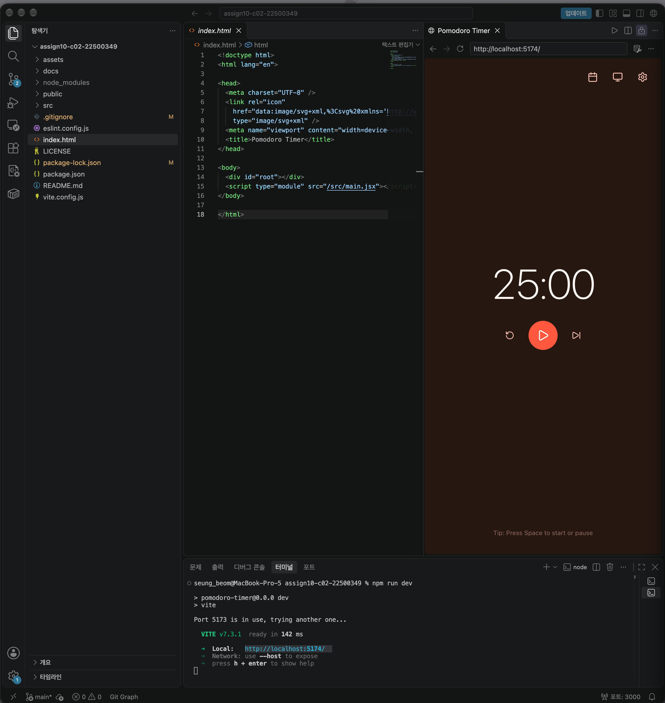
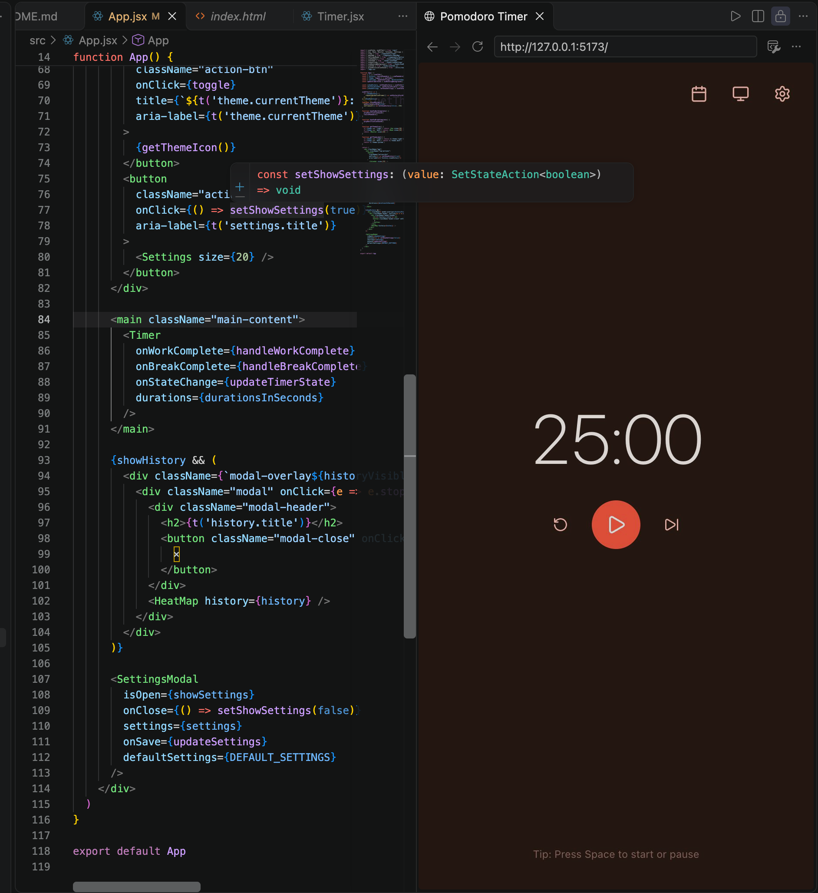
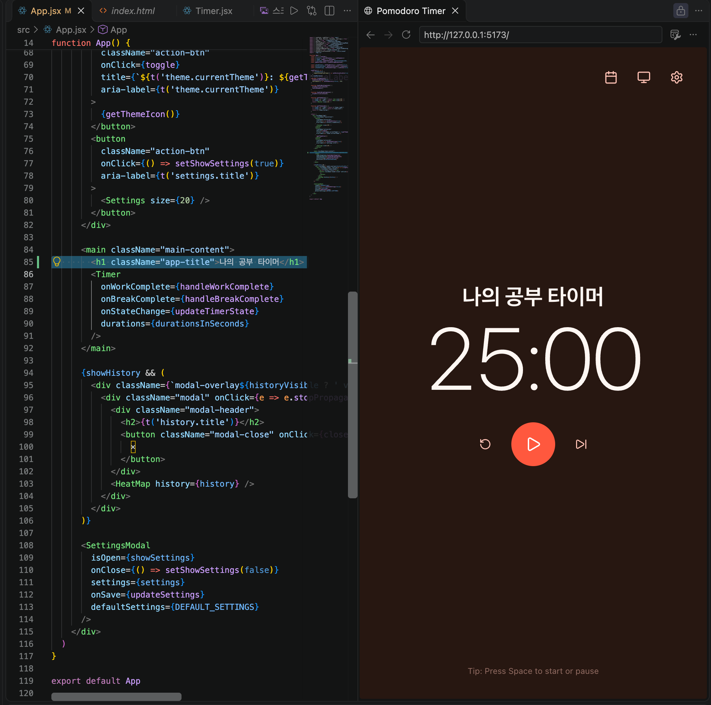
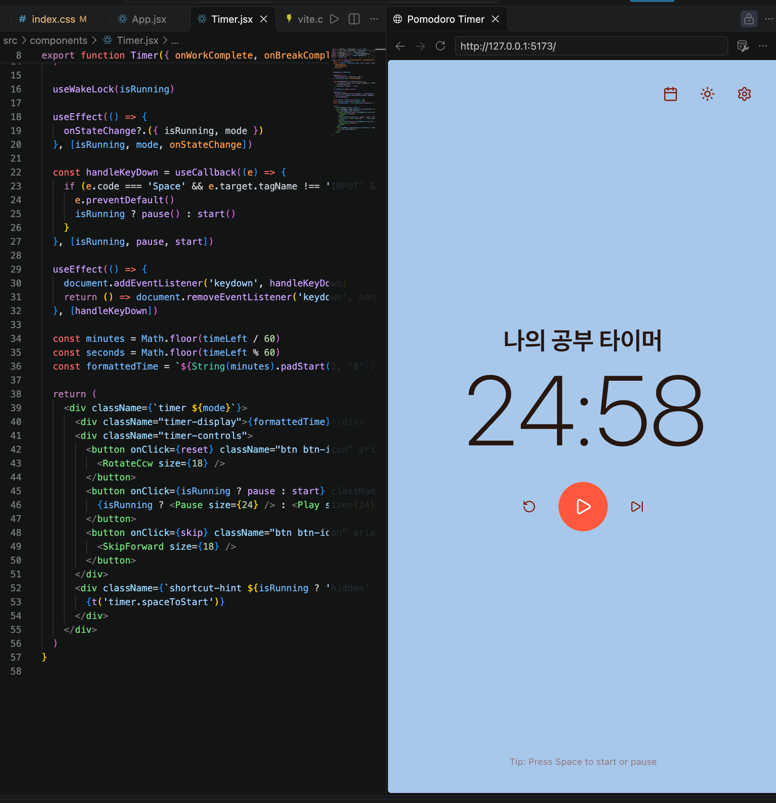
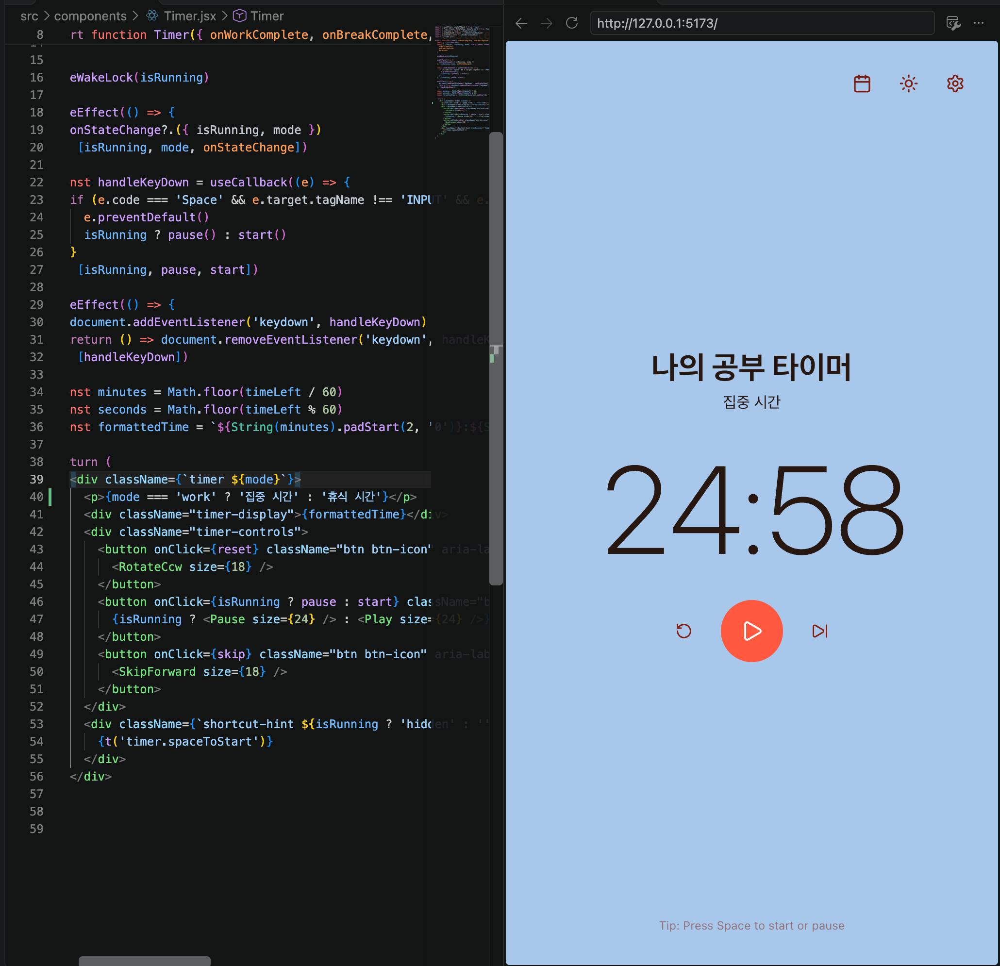
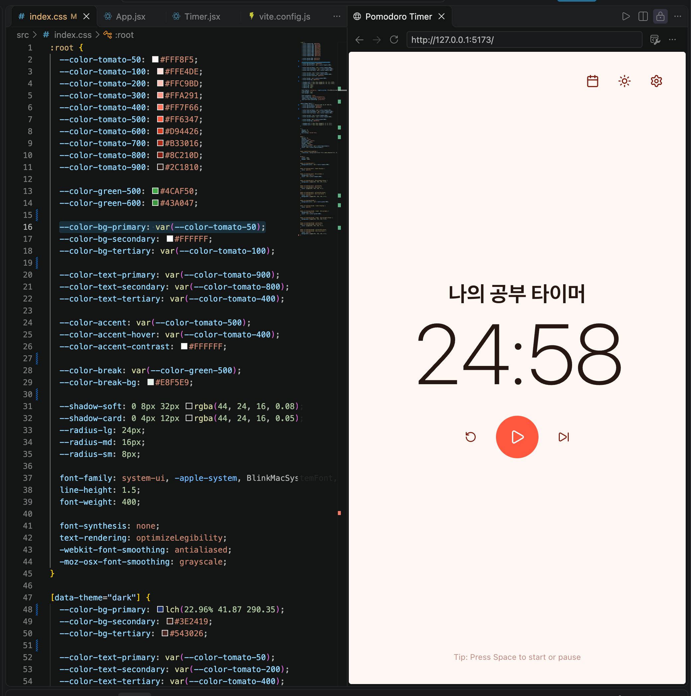
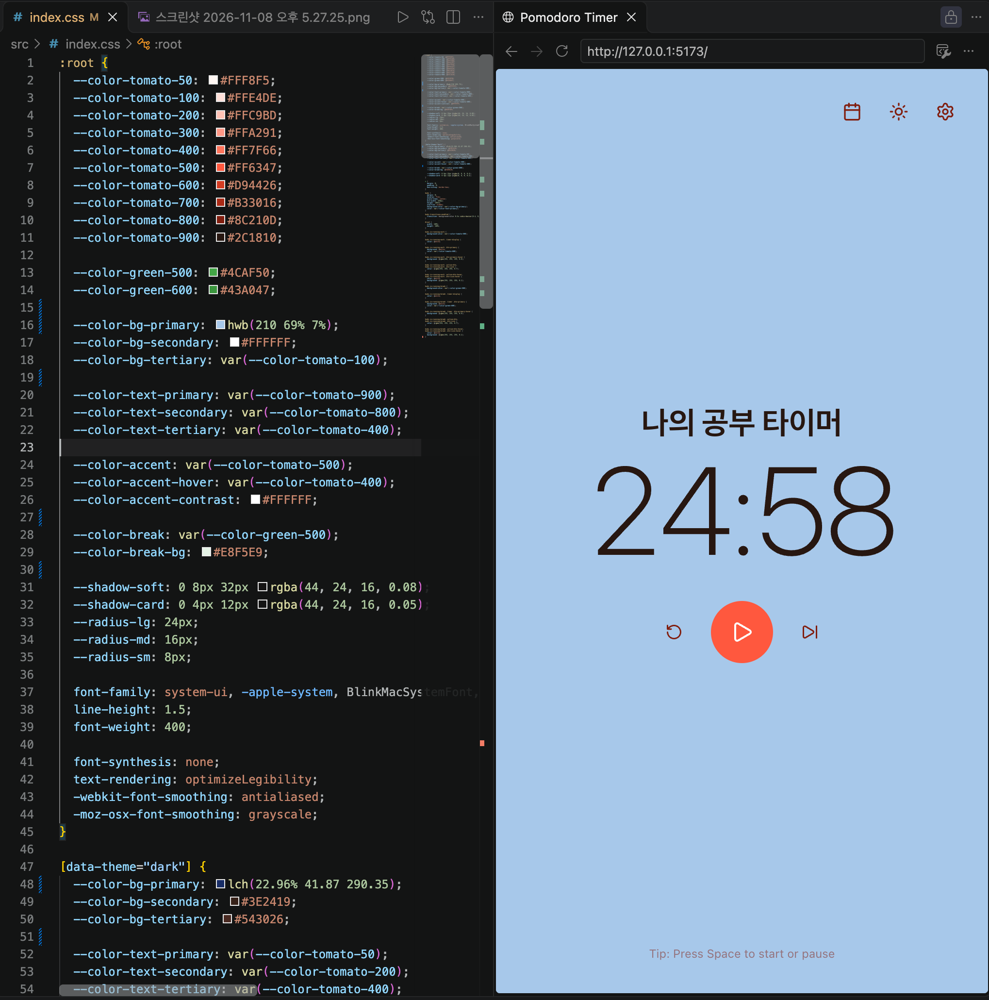
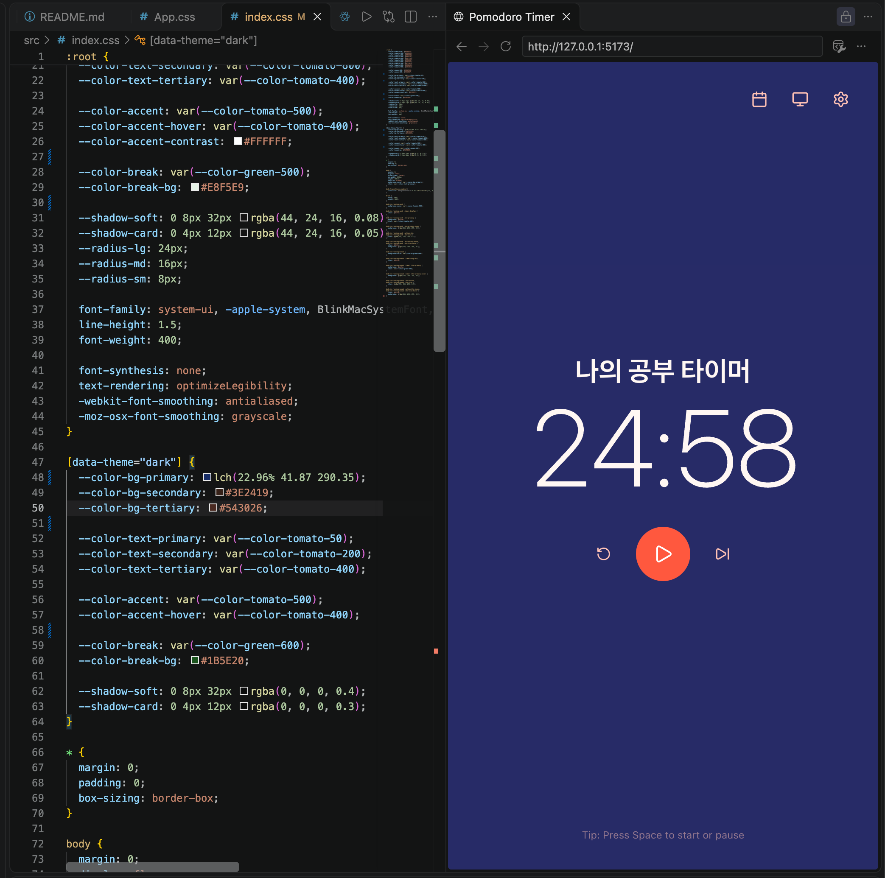
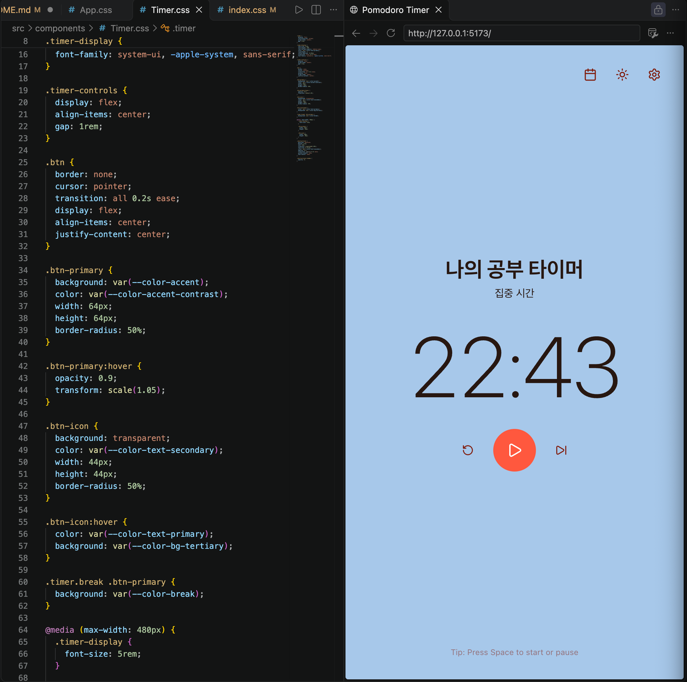
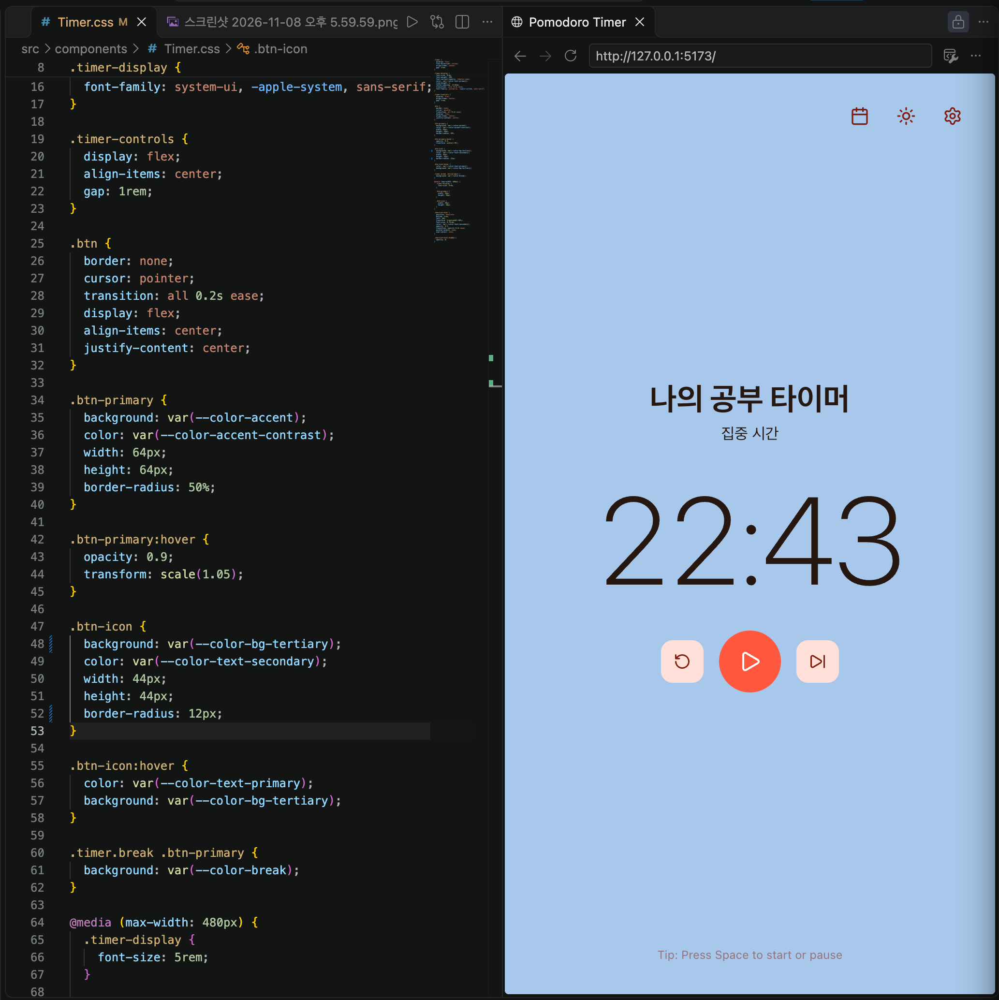

# Assignment 4-2. React Open Source Project Customizing & Deployment

## 1.Project Information

### 1-1.프로젝트 소개
이 프로젝트는 Pomodoro Timer(뽀모도로 타이머) 이며 공부할때 사용할수 있는 타이머 입니다

### 1-2.선택 이유
수업 시간에 타이머를 만들어 봤던 기억이 있어 고르게 되었으며, 좀더 실 생활에서 사용할수 있을법 한걸 만들고 수정해보고 싶었습니다

### 1-3 📄 License

This project is licensed under the [MIT](LICENSE) License.

### 1-4.출처
https://github.com/657kbps/pomodoro-timer

## 2.Installation
먼저 학교 리포지토리를 클론해 제 로컬 저장소와 연결했습니다, 다음으로 제가 선택한 깃허브를 포크 후 제 저장소에 넣었으며 이를 fetch 와 merge 로 로컬 저장소로 코드를 집어 넣었습니다, 마지막으로 npm install 로 패키지를 설치후 run dev 로 서버를 실행시켰습니다, 아래는 실행후 화면입니다.



## 3.Source Code Exploration
이 프로그램은 기본적으로 25분의 집중 시간과 5분의 짧은휴식,15분의 긴 휴식 시간을 가지고있습니다
그리고 이를 설정에서 원하는 시간만큼 조절할수 있으며 완료 횟수를 기억해 우측 상단 캘린더에 깃 허브처럼 색상으로 표시해 줍니다

### 3-1.Project Structure
위 기능을 하는데 있어 가장 주요한 파일은 *App.jsx*,  *Timer.jsx*, *useTimer.js* 이 셋 입니다
APP 은 여러 창-기능 들을 모아 앱을 구성하며 Timer는 화면의 시간,시작 정지버튼 등의 기능을 구현, useTimer은 타이머의 여러 동작들(시간이 다 지날때 다음 상태로 넘어감, 휴식-집중 모드의 타이머 함수, 받은 설정값에 따라 타이머 시간 세팅 등등)을 기능하도록 한다

### 3-2.React Component
주요 컴포넌트는 *App.jsx*,  *Timer.jsx* 이 둘입니다
App은 프로그램의 여러 컴포넌트들을 모아서 앱을 완성시킵니다, App 안을 보면 import를 통해 *Timer (타이머 화면)*, *HeatMap (완료 기록 화면)*, *SettingsModal (설정 창)* 등등 여러 기능들을 하는 각각의 컴포넌트 들을 불러오는것을 볼 수 있습니다
이중 Tmer 컴포넌트는 useTimer 스크립트가 만들어서 보내주는 값 과 함수들 (남은시간, start, stop....) 등을 밭아서 이들이 작동하도록 버튼, 공간을 만듭니다

### 3-3.Code Analysis
제가 설명할 코드는 useTimer 의 71번째 줄의 코드입니다

```jsx
const reset = useCallback(() => {
  setIsRunning(false)
  setMode('work')
  setTimeLeft(workTime)
  setPomodoroCount(0)
  remainingAtStartRef.current = workTime
}, [workTime])
```

위 코드는 Timer 에서 리셋 버튼을 눌렀을때 실행되는 함수로 위에서 부터 순서대로 설명하면
먼저 타이머가 멈추고 -> work-집중 모드로 바꾸며 -> 남은 시간에 집중모드의 시간을 넣고 -> 휴식 주기를 초기화 하고 -> 시간을 구할 기준값을 세팅합니다

## 4.Customizing

### 4-1.App.jsx


타이머 위에 제목으로로 이 타이머가 무슨 타이머 인지 적었습니다

### 4-2 Timer.jsx


이후 지금 타이머가 무슨 모드인지 알수 있도록 아래에 집중 시간,휴식 시간 이 뜨도록 하였습니다

### 4-3 index.css




기본 모드와 다크모드의 색상을 각각 연한 파란색과 진한 파란색으로 변경 했습니다

### 4-4 Timer.css


재생 버튼 좌우의 되감기,넘기기 버튼에 색을 채웠습니다


## 5.Deployment

## 6.Weekly Review:
### 6-1.새롭게 배운 내용 3가지

### 6-2.어려웠던 점과 해결 방법

### 6-3.AI 활용 내용 및 느낀 점
